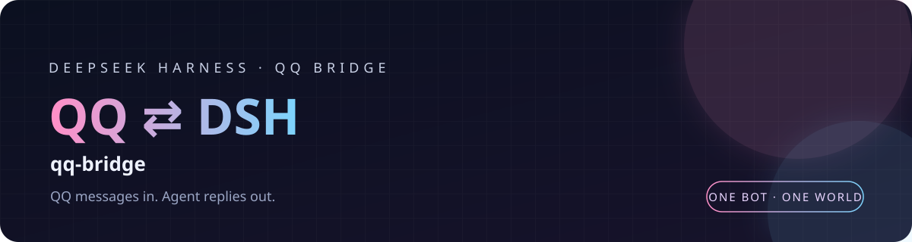

<p align="center">
  
</p>

<h1 align="center">qq-agent-presets</h1>
<p align="center"><strong>把 <code>qq-chat</code> / <code>qq-chat-v2</code> 作为 DSH agent preset 插进 QQ 桥接。</strong></p>

<p align="center">
  <a href="https://github.com/Junor-1515/qq-bridge/releases"></a>
  
  
  
</p>
<p align="center">
  <a href="#它做什么">它做什么</a> ·
  <a href="#安装">安装</a> ·
  <a href="#两个-preset">两个 preset</a> ·
  <a href="#安全守卫">安全守卫</a> ·
  <a href="#版本">版本</a>
</p>

---

> 这是 [qq-bridge](../../README.md) 的**可选组件**。桥接本体不依赖它；要用 `qq-chat` / `qq-chat-v2` 这两个 DSH preset 时再装。

## 它做什么

这是一个 **DeepSeek Harness bundle plugin**：通过两条 `@deepseek-ai/dsh-agent-preset` 行，把两个 QQ 场景专用的 agent preset 注入 DSH profile。

- **不修改 DSH 内核**，只在 profile 的 `cordis.patch.yml` 里追加 preset 行。
- 附带 `qq-tool-restrict.mjs` 安全守卫：子 agent 的工具面按白名单收窄，避免 QQ 群友通过提示词碰到本地文件、终端、插件市场等工具。
- 兼容 DSH 0.1.7+ 的 preset 机制；当前按 DSH 0.2.1-rc.2 的 preset 契约维护。

## 安装

DSH 0.1.7 起，preset 不再是 `~/.dsh/.agent-presets/<name>/` 目录，而是 profile 里的一条 bundle 依赖。把本包放到一个稳定路径，然后在 **DSH profile 的 `package.json`** 里加：

```json
{
  "dependencies": {
    "qq-agent-presets": "link:C:/Users/<you>/.dsh/plugins/qq-agent-presets"
  }
}
```

再按 DSH 的插件安装流程执行一次依赖同步，然后**重启 DSH**。重启后 preset 列表里会出现「QQ 聊天角色」和「QQ 聊天角色（二代仿真）」。

> Windows 下 `link:` 路径请写正斜杠；DSH 会用 junction 把包链进 profile 的 `node_modules`。
>
> 在本仓库里源码就在 `plugins/qq-agent-presets/`；`node scripts/setup-dsh.mjs` 会自动把它链到 `~/.dsh/plugins/qq-agent-presets`。

## 两个 preset

| preset | 场景 | 特点 |
| --- | --- | --- |
| `qq-chat` | 一代仿真 / 安全聊天 | 文本自动转回 QQ；工具面较窄；适合只想让 AI 在群里正常聊天 |
| `qq-chat-v2` | 二代仿真 `reserved2` | 文本只是思考，必须调用 `qq_send_message` 才发出去；支持看消息、引用、发表情、等回复、潜水、记忆、看视频等工具 |

`qq-chat-v2` 的完整人设、工具协议和群聊节奏都在 `presets/qq-chat-v2.patch.yml` 里。**不要手改生成物**——它由 qq-bridge 仓库的 `scripts/build-agent-preset-patches.mjs` 从 `dsh/agent-presets/qq-chat-v2/` 生成。

## 安全守卫

`qq-tool-restrict.mjs` 是 preset 的 `tool-restrict` 插件。它按白名单/黑名单裁剪子 agent 的工具面，重点挡住：

- 本地文件读写、终端、进程管理
- 插件市场、MCP 资源读取、subagent 派生
- 任何能绕过 QQ 白名单直接操作宿主机的工具

规则写在文件顶部的 `ALLOW` / `DENY` 表里，按 DSH 实际暴露的工具名维护。

## 版本

本组件跟随 qq-bridge 主仓库统一发版：推送到 `main` 后，GitHub Actions 会把根包和 `plugins/*` 的版本一起 bump，并提交 `chore(release): ... [skip version]`。想跳过某次自动 bump，在 commit message 里写 `[skip version]`。

## License

MIT

---

本组件随 [qq-bridge](../../README.md) 一起发布。
